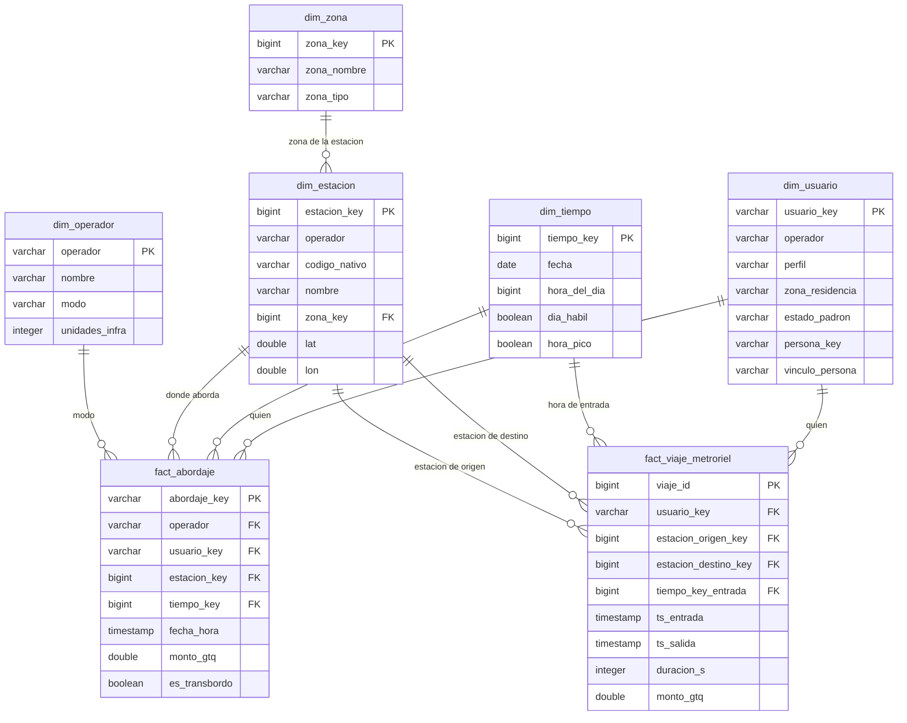

# Diagrama del modelo de Gold

Hay dos tablas de hechos y cinco dimensiones. Las dimensiones se comparten
entre las dos tablas de hechos, y por eso se pueden cruzar sin reconciliar
nada (ver docs/matriz_bus.md).

## Cómo leerlo

fact_abordaje es la tabla principal. Cada fila es un abordaje: una persona que
entra a un modo, en una estación o parada, a una hora. Entran los cuatro
operadores, y de MetroRiel se toma la entrada del viaje.

fact_viaje_metroriel es la segunda y solo existe para MetroRiel. Cada fila es
un viaje completo, con estación de entrada y de salida. Apunta dos veces a
dim_estacion, una por el origen y otra por el destino.

La zona de un abordaje no está en la tabla de hechos sino en la estación:
fact_abordaje llega a dim_zona pasando por dim_estacion.

usuario_key es un seudónimo de la tarjeta de un operador. persona_key, que
vive en dim_usuario, agrupa tarjetas bajo el supuesto que se explica en
docs/decisiones.md.

## Medidas

monto_gtq es aditiva: se puede sumar por zona, hora, operador o lo que sea.
El conteo de abordajes o de viajes también. duracion_s no es aditiva, solo se
promedia. es_transbordo es una marca y se cuenta, no se suma.

## Dimensiones que sirven a las dos tablas

dim_tiempo, dim_estacion y dim_usuario las usan los dos hechos. dim_zona se
llega desde dim_estacion. dim_operador la usa solo fact_abordaje porque el
operador de fact_viaje_metroriel siempre es MetroRiel.
