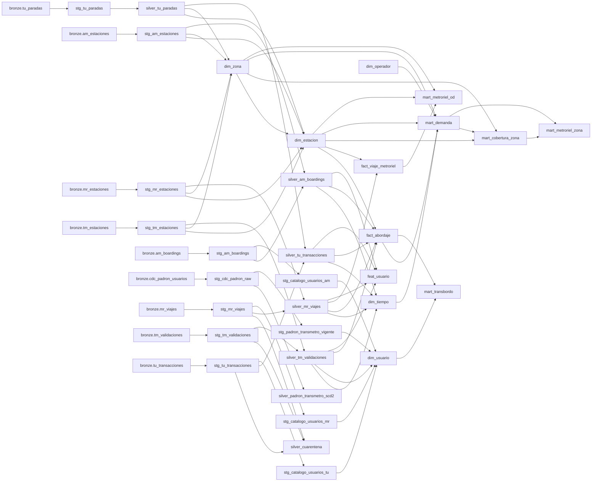

# Linaje de datos

Generado con src/ingesta/exportar_linaje.py a partir del manifest de dbt.
Cada modelo de gold se puede seguir hacia atras hasta el archivo crudo en bronze.
Para verlo de forma interactiva: `dbt docs generate` y `dbt docs serve` dentro de dbt_project.

