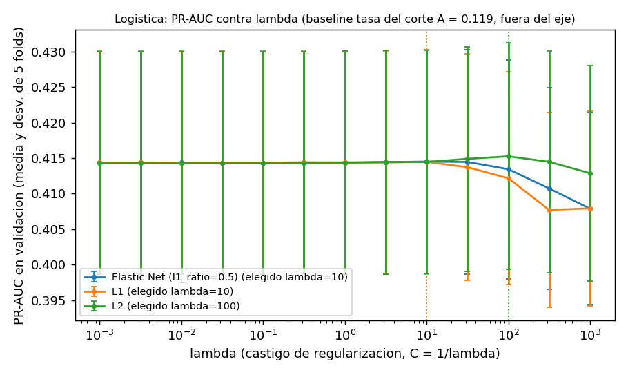

# Proyecto 2 - Informe de la Fase 1

Agencia Metropolitana de Transporte: ¿quién deja de usar la red?
Universidad Rafael Landívar, Ciencia de Datos, segundo semestre 2026.
Daniel Paz (1200022) y Jonathan García (1045222).

Los datos son simulados y no corresponden a ningún operador ni usuario real.

## 1.1 Datos nuevos desde cero

Comando único, desde un entorno vacío:

```
python orquestacion/flow_prefect.py --desde-cero
```

Vacía el lake (bronze/), el warehouse (warehouse.duckdb) y los artefactos de
dbt, carga los nueve archivos de datos_red/, corre staging, silver y gold,
las pruebas de dbt, y calcula las features de los tres cortes. No hay pasos
manuales: dbt crea sus vistas de Bronze en el on-run-start y no usamos
seeds, snapshots ni tablas incrementales (Silver y Gold se recalculan
completos en cada corrida, y Staging lee solo la última entrega de Bronze).

| Archivo | Filas esperadas | Filas cargadas en Bronze | Diferencia |
|---|---:|---:|---:|
| aerometro_boardings.csv | 387,053 | 387,053 | 0 |
| am_estaciones.csv | 14 | 14 | 0 |
| cdc_padron_usuarios.csv | 77,636 | 77,636 | 0 |
| metroriel_viajes.jsonl | 590,844 | 590,844 | 0 |
| mr_estaciones.csv | 22 | 22 | 0 |
| tm_estaciones.csv | 104 | 104 | 0 |
| transmetro_validaciones.csv | 713,786 | 713,786 | 0 |
| transurbano_transacciones.csv | 1,635,788 | 1,635,788 | 0 |
| tu_paradas.csv | 328 | 328 | 0 |

Las nueve diferencias son 0, así que no hay nada que explicar: Bronze recibe exactamente las filas del archivo crudo. La limpieza (duplicados, nulos, fechas futuras, viajes sin salida) ocurre después, en Silver, y lo rechazado queda en cuarentena.

Tiempos de la corrida desde cero:

| Etapa | Segundos |
|---|---:|
| vaciar lake y warehouse | 0.2 |
| ingesta a bronze | 1.8 |
| dbt run (staging, silver, gold) | 38.1 |
| dbt test | 16.4 |
| exportar csv del tablero | 0.3 |
| features cortes A, B y C | 10.3 |
| total | 67.1 |


## 1.2 Etiqueta, población y unidad

**Etiqueta.** Una unidad tiene etiqueta 1 si no registra ningún abordaje
válido en Silver, en ningún operador, entre las 00:00 del día de corte y las
00:00 del día 30 después del corte; si registra al menos uno, su etiqueta es 0.

**Unidad: la persona.** En el Proyecto 1 dejamos dos niveles de identidad:
usuario_key (una tarjeta de un operador) y persona_key (el supuesto
declarado de que el número dentro de la tarjeta, como TC-00013132, 0000013132
y MR0013132, es la misma persona). Con la tarjeta como unidad, alguien que
deja Transmetro pero sigue en Transurbano cuenta como abandono, y eso es
justo lo que la Agencia no quiere pagar. Por eso usamos la persona, con el
mismo supuesto del Proyecto 1, y dejamos Aerómetro como persona aparte
porque entrega un hash que no se puede vincular.

**Población.** Entra a un corte la unidad con al menos 2 abordajes válidos
en los 28 días anteriores y cuyo último evento del CDC antes del corte no es
un DELETE (la llave del CDC se vincula a la persona con el mismo número).

| Corte | Fecha | Población | Positivos | Tasa positiva | Cuenta |
|---|---|---:|---:|---:|---|
| A | 2026-07-01 | 59,491 | 7,095 | 0.1193 | 7,095 / 59,491 = 0.1193 |
| B | 2026-07-31 | 58,113 | 6,387 | 0.1099 | 6,387 / 58,113 = 0.1099 |
| C | 2026-08-30 | 57,701 | oculta | - | - |

**Costo de la unidad.** Lo medimos de dos formas (python -m ml.costo_unidad):

1. Lo que evita la persona. Armamos la misma población y etiqueta pero con
   la tarjeta como unidad. En el corte A hay 10,812 tarjetas positivas, y en
   2,404 de ellas la persona siguió viajando con otra tarjeta: 2,404 de 10,812
   positivos = 0.222. En el corte B: 2,400 de 10,004 = 0.240. Con la tarjeta,
   uno de cada cinco abandonos sería falso.
2. Lo que nos cuesta la persona. Las tarjetas de Aerómetro no se pueden
   enlazar con ninguna otra, así que cada una es una persona. En el corte A
   son 10,429 de 59,491 unidades, y 1,460 de 7,095 positivos = 0.206 son solo
   de Aerómetro. Si alguna de esas personas siguió viajando con una tarjeta
   de otro operador, es un abandono falso que no podemos medir. En el corte B:
   1,360 de 6,387 = 0.213.

## 1.3 Features a la fecha de corte y auditoría de fuga

El código recibe la fecha de corte como parámetro (ml/features.py, función
construir). Calcula los tres cortes con el mismo código y los apila en una
sola tabla con la fecha de corte como columna: 175,305 filas (59,491 de A,
58,113 de B y 57,701 de C), una por unidad y corte. Está en el warehouse
(main_ml.features) y en ml/salidas/features_cortes.parquet. Columnas:
unidad_id, corte, fecha_corte, tarjetas, las 19 features y etiqueta (vacía
en C).

Todas las ventanas miden 28 días o menos y son iguales en los tres cortes.
Solo se usan registros válidos: las features salen de las tablas de Silver,
y lo que está en cuarentena no llega a ellas. El diccionario completo está
en docs/proyecto2/diccionario_features.md.

**Prueba de recorte.** Calculamos las features del corte A con los datos
completos y con los datos recortados al 30 de junio, en dos niveles:

| Nivel | Qué se recorta | Filas comparadas | Diferencias |
|---|---|---:|---:|
| Silver | eventos de Silver y CDC anteriores al 1 de julio | 59,491 | 0 |
| Crudo | los 9 archivos de datos_red al 30 de junio, y se corre el pipeline completo en una copia aislada del proyecto | 59,491 | 0 |

Ninguna feature falló, así que la lista de features corregidas está vacía.
El nivel crudo es el más exigente, porque también atraparía una fuga del
pipeline (por ejemplo una deduplicación o un catálogo calculado con datos
futuros). En ese nivel, un viaje de MetroRiel solo se conserva si ya cerró
antes del corte, porque el operador entrega el viaje cerrado. Se repite con
python -m ml.prueba_recorte --nivel silver y --nivel crudo.

## 1.4 Línea base y regresión logística regularizada

**Métrica: PR-AUC (average precision).** Solo el 11.9% de la población del
corte A abandona, y la Agencia no va a contactar a todos: va a ordenar a las
personas por riesgo y contactar a las de arriba. La PR-AUC mide justamente
qué tan concentrados quedan los que se van en la parte alta de esa lista, y
no se infla con los miles de negativos fáciles como la ROC-AUC. Además, su
línea base es intuitiva: un modelo que no sabe nada saca la tasa positiva,
0.119. Reportamos la ROC-AUC al lado como referencia.

Todos los modelos usan los mismos 5 folds estratificados del corte A
(semilla 42, guardados en ml/salidas/folds_A.csv). La etiqueta del corte B no
se usó en esta fase. Las variables numéricas se escalan y el perfil se
codifica con one-hot dentro de un Pipeline, así que el escalado se ajusta
solo con el fold de entrenamiento.

| Modelo | PR-AUC validación (media) | Desv. estándar | ROC-AUC validación |
|---|---:|---:|---:|
| Baseline 1: a todos la tasa del corte A (0.119) | 0.119 | 0.000 | 0.500 |
| Baseline 2: días desde el último viaje | 0.403 | 0.014 | 0.826 |
| Baseline 3: menos viajes en 28 días | 0.254 | 0.004 | 0.743 |
| Logística L2, λ = 100 | **0.415** | 0.016 | 0.831 |
| Logística L1, λ = 10 | 0.414 | 0.016 | 0.831 |
| Logística Elastic Net (l1_ratio 0.5), λ = 10 | 0.415 | 0.016 | 0.831 |

El baseline 2 usa una sola feature sin entrenar nada: quien lleva más días
sin viajar queda con más riesgo. Lo elegimos porque dejar de viajar es,
literalmente, el principio del abandono. Es un baseline muy fuerte: la
logística solo le gana 0.012 de PR-AUC, menos que una desviación estándar
entre folds. Eso dice que la mayor parte de la señal está en la recencia, y
que lo demás aporta poco.

**Regularización y λ.** En scikit-learn 1.8 el castigo se elige con l1_ratio
(0 = L2, 1 = L1, 0.5 = Elastic Net) y su fuerza con C = 1/λ. Barrimos λ de
0.001 a 1,000 y elegimos el de mayor PR-AUC media en validación: L2 con
λ = 100, y L1 y Elastic Net con λ = 10. Con 47,000 filas de entrenamiento por
fold y 19 features, castigar poco o mucho cambia muy poco hasta λ = 10; de
ahí para arriba L1 y Elastic Net empiezan a perder porque anulan coeficientes
útiles. Los tres castigos quedan prácticamente empatados.



**Coeficientes que más empujan hacia el abandono** (L2, λ = 100, ajustada con
todo el corte A sobre variables escaladas):

| Feature | Coeficiente | Interpretación |
|---|---:|---|
| dias_desde_ultimo_viaje | +0.764 | Cada día de más sin viajar antes del corte sube el riesgo; es la señal más fuerte. |
| viajes_28d | +0.332 | Con los viajes recientes y los días activos fijos (viajes_7d −0.519, dias_activos_28d −0.633), más viajes en el mes completo quiere decir que viajaba antes y ya no: describe una caída. |
| perfil general | +0.227 | Las personas con perfil general abandonan más (17.5% en el corte A contra 11.9% de toda la población). |
| perfil estudiante | +0.100 | También abandonan por encima del promedio: 15.9% en el corte A. |
| viajes_14d | +0.086 | Igual que viajes_28d: con los últimos 7 días fijos, viajes concentrados en la semana anterior y no en la última indican que se está yendo. |

Del lado contrario, lo que más protege es tener muchos días activos
(−0.633), viajes en la última semana (−0.519) y estar fuera del padrón
(−0.312): en el corte A abandona el 11.3% de quienes no están en el
padrón, contra 12.2% a 17.5% de los que tienen un perfil registrado.

