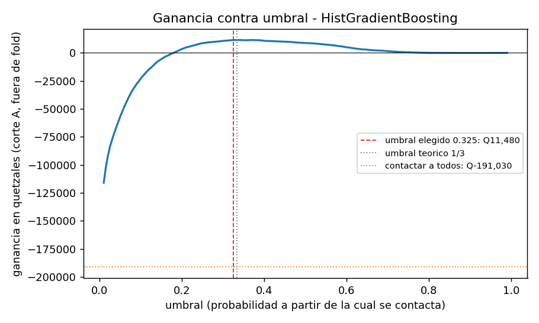
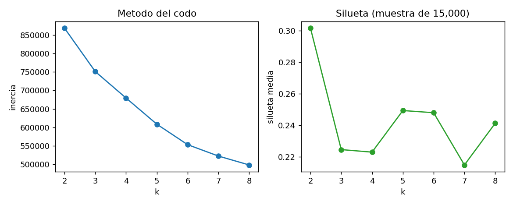
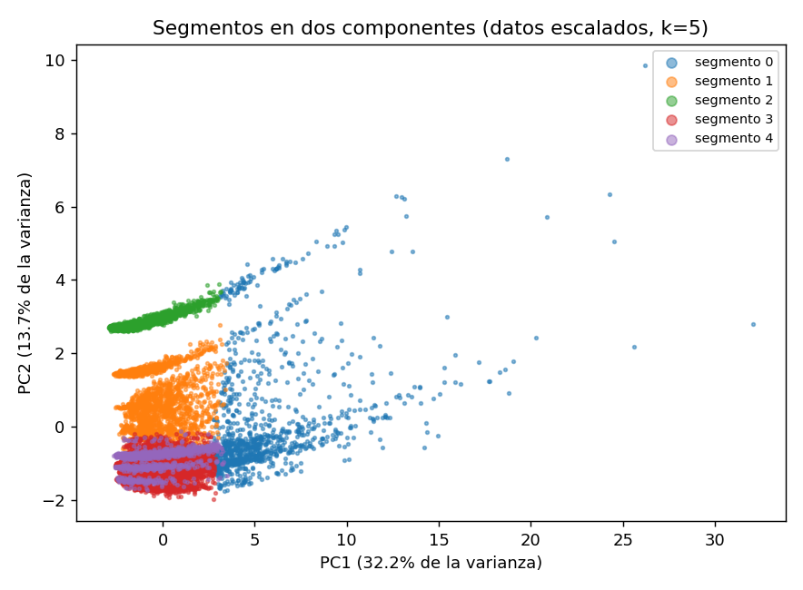

# Proyecto 2 - Fase 2

## Introducción

En la Fase 1 cargamos los datos, definimos la etiqueta y probamos una
regresión logística. En esta fase probamos modelos de ensemble, elegimos el
umbral según lo que cuesta contactar a alguien, evaluamos una sola vez en
el corte B, separamos a los usuarios en segmentos y dejamos el modelo listo
para usarse con datos nuevos.

Para leer esta fase hay que recordar que la unidad es la persona y que la
etiqueta es 1 si la persona no viaja en los 30 días siguientes al corte. En
el corte A, del 1 de julio, abandonan 7,095 de 59,491 personas, que es
0.1193. En el corte B, del 31 de julio, abandonan 6,387 de 58,113, que es
0.1099. Comparamos los modelos con la PR-AUC usando los mismos 5 folds del
corte A con semilla 42.

Los datos son simulados y no corresponden a ningún operador ni usuario
real.

## Ensemble y sesgo-varianza

Entrenamos dos ensembles con los mismos folds de la Fase 1. El primero es
un HistGradientBoostingClassifier, que es boosting, con 300 árboles de
hasta 31 hojas, tasa de aprendizaje de 0.05 y mínimo 100 personas por
hoja. El segundo es un Random Forest, que es bagging, con 300 árboles y
mínimo 20 personas por hoja. A los árboles no les hace falta escalar las
variables, solo el perfil se pasa a one-hot dentro del Pipeline.

| Modelo | PR-AUC entrenamiento | PR-AUC validación | ROC-AUC |
|---|---:|---:|---:|
| Línea base 1: tasa del corte A | 0.119 | 0.119 ± 0.000 | 0.500 |
| Línea base 2: días desde el último viaje | 0.402 | 0.403 ± 0.014 | 0.826 |
| Línea base 3: menos viajes en 28 días | 0.254 | 0.254 ± 0.004 | 0.743 |
| Logística L2, λ = 100 | 0.416 | 0.415 ± 0.016 | 0.831 |
| Logística L1, λ = 10 | 0.415 | 0.414 ± 0.016 | 0.831 |
| Logística Elastic Net, λ = 10 | 0.415 | 0.415 ± 0.016 | 0.831 |
| HistGradientBoosting | 0.544 | 0.426 ± 0.015 | 0.841 |
| Random Forest | 0.533 | 0.424 ± 0.014 | 0.841 |

### Sesgo y varianza de cada modelo

Las líneas base tienen sesgo alto. No aprenden nada, son una constante o
una sola variable, y por eso sacan lo mismo en entrenamiento y en
validación.

La logística también tiene sesgo alto. Entrenamiento y validación quedan
casi iguales, 0.416 contra 0.415, así que no se sobreajusta, pero una
frontera lineal no saca mucho más de lo que ya da la recencia. Bajar la
regularización tampoco ayudó, como se vio en la curva de λ.

El boosting tiene varianza moderada. En entrenamiento saca 0.118 más que en
validación, pero su validación es la mejor de todas. El mínimo de 100
personas por hoja es lo que mantiene ese sobreajuste bajo control.

El Random Forest se comporta parecido al boosting, con una brecha de 0.109,
y queda apenas por debajo en validación.

### Importancia por permutación

La calculamos para el boosting en cada fold de validación, no en
entrenamiento, usando la PR-AUC, y la promediamos en los 5 folds. El
número es cuánto baja la PR-AUC cuando se revuelve esa variable.

| # | Feature | Baja en PR-AUC | Desviación |
|---:|---|---:|---:|
| 1 | Días desde el último viaje | 0.2457 | 0.0147 |
| 2 | Perfil | 0.0152 | 0.0056 |
| 3 | Tendencia en 14 días | 0.0103 | 0.0035 |
| 4 | Viajes en 14 días | 0.0090 | 0.0049 |
| 5 | Viajes en 7 días | 0.0084 | 0.0066 |
| 6 | Días activos en 28 días | 0.0073 | 0.0051 |
| 7 | Viajes en 28 días | 0.0066 | 0.0032 |
| 8 | Número de zonas | 0.0051 | 0.0033 |
| 9 | Gasto en 28 días | 0.0045 | 0.0029 |
| 10 | Proporción en hora pico | 0.0033 | 0.0019 |

La recencia es lo que más pesa. Sin ella el modelo pierde 0.25 de PR-AUC y
las demás variables aportan poco cada una. Las proporciones por operador y
el número de operadores no aportan nada.

### Modelo elegido

Elegimos el boosting para producción. Le gana a la logística en los 5
folds y no solo en el promedio, por entre 0.007 y 0.016 de PR-AUC, y con el
mejor umbral de cada uno deja Q11,480 contra Q11,015 en el corte A. La
mejora no es grande, pero tampoco cuesta mucho: entrena en 2 segundos, se
guarda en un solo archivo junto con el preprocesamiento y con la
importancia por permutación podemos explicar qué está usando. Si la
Agencia necesitara justificar cada contacto con un coeficiente, la
logística sería la otra opción, aunque deje menos ganancia.

## Umbral según el costo y test único

### Ganancia

Contactar a una persona cuesta Q5. Si esa persona se iba a ir, la campaña
logra retenerla una de cada cuatro veces, y una persona retenida vale Q60.
Con eso, contactar a alguien que se iba deja en promedio 0.25 por 60 menos
5, que son Q10. Contactar a alguien que no se iba solo cuesta los Q5. La
ganancia de una campaña queda así:

```
G = 10 × VP − 5 × FP
```

Si las probabilidades del modelo estuvieran bien calibradas, convendría
contactar a quien tenga p por 15 menos 5 mayor que cero, o sea p mayor que
5 entre 15, que es 1/3.

### Umbral elegido

Probamos umbrales de 0.01 a 0.99 cada 0.005 sobre las predicciones fuera de
fold del corte A y nos quedamos con el que dio más ganancia, que fue 0.325.
Queda casi en el 1/3 de la teoría, lo que indica que las probabilidades del
boosting están bastante bien calibradas.

| Corte A, fuera de fold | Umbral 0.325 | Umbral 1/3 | Contactar a todos |
|---|---:|---:|---:|
| Contactados | 6,320 | 6,009 | 59,491 |
| Verdaderos positivos | 2,872 | 2,767 | 7,095 |
| Falsos positivos | 3,448 | 3,242 | 52,396 |
| Precisión | 0.454 | 0.460 | 0.119 |
| Recall | 0.405 | 0.390 | 1.000 |
| Ganancia | Q11,480 | Q11,460 | −Q191,030 |

Con el umbral de 0.325 la cuenta es 10 por 2,872 menos 5 por 3,448, que da
Q11,480. Contactar a todos haría perder más de Q191,000.



### Test en el corte B

El 3 de noviembre de 2026 a la 1:44, en el commit 3a6bb7c, entrenamos el
boosting con todo el corte A, lo guardamos y lo evaluamos una sola vez en
el corte B. El script que lo hace no deja correrlo otra vez si ya existe el
resultado o si hay cambios sin guardar en git.

| Corte B | Valor |
|---|---:|
| PR-AUC del modelo | 0.386 |
| Línea base de la tasa | 0.110 |
| Línea base de días sin viajar | 0.359 |
| ROC-AUC | 0.839 |
| Verdaderos positivos | 2,746 |
| Falsos positivos | 3,982 |
| Falsos negativos | 3,641 |
| Verdaderos negativos | 47,744 |
| Precisión | 0.408 |
| Recall | 0.430 |
| Ganancia | Q7,550 |

El resultado es más bajo que en validación, donde teníamos 0.426 y
Q11,480, y no ajustamos nada después de verlo. La razón principal es que en
B abandona menos gente, 11.0% contra 11.9% en A. La PR-AUC y la ganancia
dependen de cuántos positivos hay, y con menos personas por irse cada
contacto acierta menos aunque el orden de la lista sea igual de bueno. La
ROC-AUC, que no depende de esa tasa, casi no cambió: 0.841 en validación y
0.839 en B. La línea base de recencia también bajó en la misma proporción,
de 0.403 a 0.359, y contra ella el modelo gana por más en B, 0.027, que en
validación, 0.023.

## Segmentación con KMeans y PCA

Corrimos KMeans sobre las 18 features numéricas del corte A ya escaladas.
El perfil no entra porque es una categoría. Probamos k de 2 a 8. La
silueta más alta fue con k = 2, de 0.302, pero solo separa a los que viajan
muchísimo del resto y eso no sirve para pensar campañas. El siguiente pico
de silueta fue k = 5, con 0.249, justo donde el codo se empieza a aplanar,
así que nos quedamos con 5 segmentos.



Proyectamos los datos en dos componentes principales, que juntas explican
el 45.9% de la varianza. La primera explica 32.2% y la segunda 13.7%.



| Segmento | Personas | Viajes en 28 días | Días activos | Días sin viajar | Operador principal | Abandono |
|---|---:|---:|---:|---:|---|---:|
| Viajeros intensivos | 5,461 | 53 | 21 | 0.3 | Transurbano y otro | 0.019 |
| Usuarios de MetroRiel | 10,082 | 9 | 7 | 2.6 | MetroRiel | 0.125 |
| Usuarios de Aerómetro | 10,028 | 6 | 5 | 3.7 | Aerómetro | 0.145 |
| Usuarios de Transurbano | 25,482 | 9 | 7 | 2.6 | Transurbano | 0.118 |
| Usuarios de Transmetro | 8,438 | 9 | 7 | 2.6 | Transmetro | 0.149 |

Los valores son medianas. La tasa de abandono de cada segmento solo
describe dónde se concentra el abandono, no quiere decir que el segmento lo
cause. El segmento tampoco se usa como feature del modelo.

### Acciones de retención

Para los usuarios de Transmetro, que tienen la tasa más alta con 14.9%,
proponemos una recarga de cortesía que solo se active si vuelven a viajar
la semana siguiente, junto con un aviso de las frecuencias de sus líneas.

Para los usuarios de Aerómetro, con 14.5%, un transbordo sin costo hacia
Transmetro o Transurbano, para que el teleférico no sea un viaje aislado.
Hay que tomar en cuenta que en este segmento no podemos saber si la persona
sigue viajando con otra tarjeta.

Para los usuarios de MetroRiel, con 12.5%, un pase semanal con descuento,
porque viajan sobre todo en días hábiles y en hora pico.

Para los viajeros intensivos, con 1.9%, no vale la pena gastar presupuesto
de la campaña. Basta con algún reconocimiento que no cueste.

## Puesta en producción

El modelo se usa con el script predecir.py. Recibe la carpeta de datos y la
fecha de corte:

```
python predecir.py --datos datos_red --fecha-corte 2026-08-30
```

El script carga los datos con el pipeline desde cero, calcula las features
del corte, carga el modelo guardado y escribe un CSV con el identificador
de la persona, sus tarjetas, el puntaje y si hay que contactarla. No vuelve
a entrenar.

El modelo está guardado en la carpeta modelos como modelo_abandono_v1. El
archivo trae el Pipeline completo con el preprocesamiento, el umbral, la
lista de columnas, el commit y la versión de scikit-learn. Las versiones
de todas las librerías están fijas en requirements.txt, la semilla es 42 en
todo el proyecto y los pasos para correr todo están en el README.

Para el corte C, del 30 de agosto, el modelo evaluó a 57,701 personas y
recomienda contactar a 7,872. La ficha del modelo va en un documento
aparte.

### Ensayo de la prueba de invariancia

Todavía no tenemos los datos de septiembre, pero con el corte B se puede
hacer la misma prueba. Predijimos el corte B con los archivos recortados al
31 de julio y otra vez con los datos completos, que traen 30 días más. Los
dos archivos salieron idénticos, con 58,113 filas y ninguna diferencia.

En ese ensayo encontramos un problema. Dos corridas de predecir.py con los
mismos datos daban 2,759 puntajes distintos. DuckDB suma en paralelo, y la
suma de tarifas con decimales como Q1.30 cambiaba en el último decimal
según el orden en que terminaban los hilos. El boosting parte las variables
en intervalos y esa diferencia tan pequeña movía a algunas personas de un
intervalo a otro. Lo arreglamos sumando el gasto en centavos enteros. No
reentrenamos el modelo ni repetimos el test en B, porque el dato es el
mismo y solo cambió cómo se suma. Desde ese cambio, tres corridas seguidas
dan exactamente el mismo archivo.

## Resumen de métricas

| Tema | Resultado |
|---|---|
| Problema | Tasa de abandono de 0.1193 en A y 0.1099 en B. 57,701 personas en C. |
| Validación | PR-AUC de 0.426 del boosting, contra 0.403 de la recencia y 0.119 de la tasa. |
| Decisión | Umbral de 0.325, precisión de 0.454, recall de 0.405 y Q11,480 en A. |
| Test | Corte B, 3 de noviembre, commit 3a6bb7c. PR-AUC de 0.386 y Q7,550. |
| Fuga | Prueba de recorte sin diferencias en Silver ni en crudo. Invariancia ensayada con B sin diferencias. |
| Tiempos | Carga desde cero entre 25 y 67 segundos según la máquina. Features de los 3 cortes entre 4 y 10 segundos. Entrenamiento final en 2 segundos. predecir.py en 38 segundos con el pipeline incluido. |

## Conclusión

El modelo le gana a todas las líneas base, aunque por poco a la de
recencia, porque casi toda la señal está en cuántos días lleva la persona
sin viajar. Con el umbral que sale del costo, contactar a unas 7,900
personas en el corte C deja ganancia, mientras que contactar a todos haría
perder dinero. Los segmentos le dicen a la Agencia que conviene empezar
por los usuarios de Transmetro y de Aerómetro.
